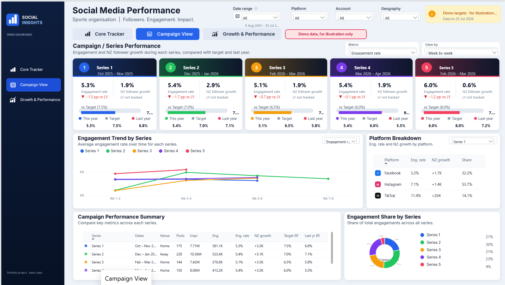
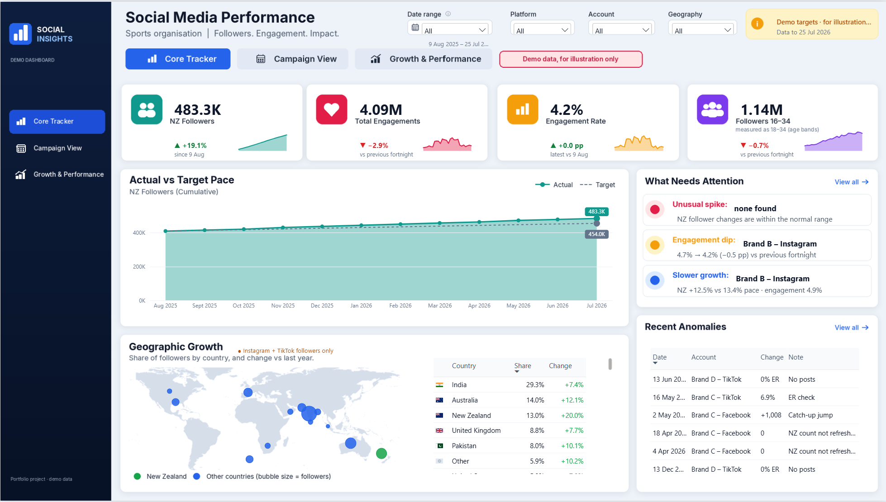
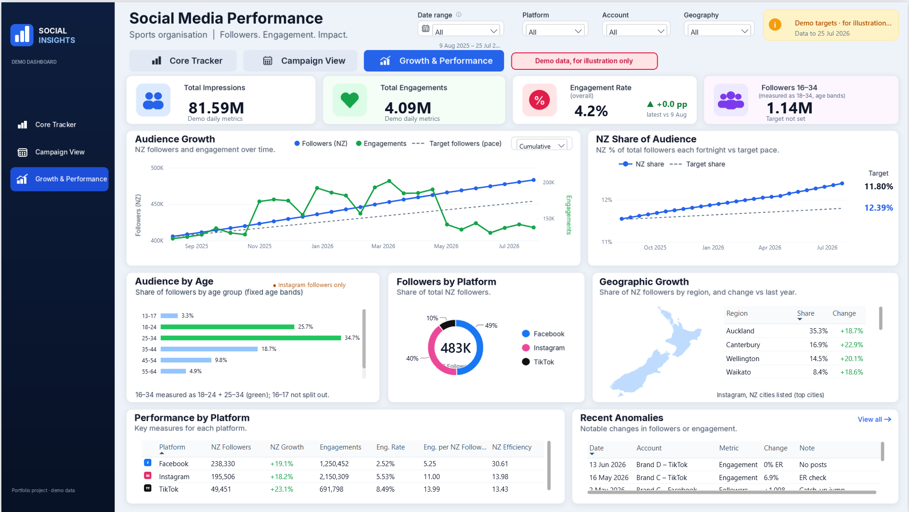
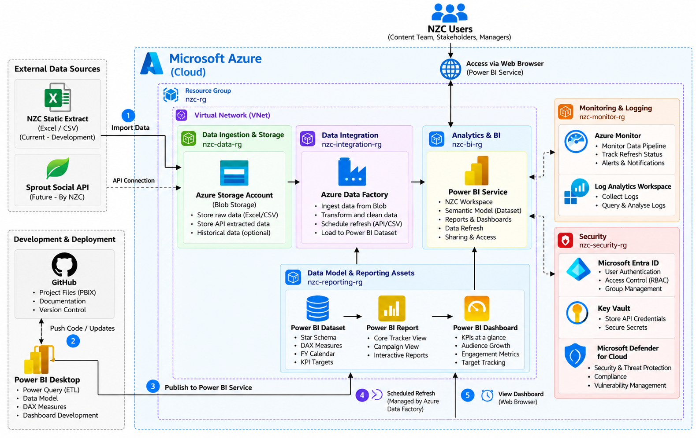

# Social Media Performance Dashboard (Power BI)


> **Demo data, for illustration only.** All figures, account names, campaign names and targets in these screenshots are invented. None of them are real.

A three-page Power BI dashboard that tracks how a sports organisation's social audience grows and how well it engages across **Facebook, Instagram and TikTok**. It shows results against targets and against last year.

This project was completed with **New Zealand Cricket** during the **2026 virtual internship**, as part of a **five-person team**.

---

## Table of Contents

- [Dashboard Pages](#dashboard-pages)
- [Architecture](#architecture)
- [Deployment Plan](#deployment-plan)
- [How It Was Built](#how-it-was-built)
- [Tools & Technologies](#tools--technologies)
- [Repository Structure](#repository-structure)
- [Note on Sharing](#note-on-sharing)

---

## Dashboard Pages

### 1. Core Tracker
**The headline view: are we on track?**

- Four KPI cards with sparklines: NZ followers, total engagements, engagement rate and followers aged 16–34.
- **Actual vs Target Pace** chart showing cumulative NZ followers against the straight-line pace needed to hit the year-end target.
- **What Needs Attention**, which automatically flags unusual spikes, engagement dips and slower-than-target growth.
- **Geographic Growth**: a world bubble map and a table of countries by share and change.
- **Recent Anomalies**: a data-quality log covering missing posts, stale counts and catch-up jumps.



### 2. Campaign View
**How did each campaign or series perform?**

- Five series cards, each showing engagement rate, NZ follower growth and progress vs target, with this year, target and last year side by side.
- **Engagement Trend by Series**, week by week through each series.
- **Platform Breakdown** for the selected series.
- A **Campaign Performance Summary** table and an **Engagement Share by Series** donut.



### 3. Growth & Performance
**The deeper dive.**

- **Audience Growth**: followers vs engagements over time, plus target pace, with a Cumulative / Fortnightly toggle.
- **NZ Share of Audience** vs target share.
- **Audience by Age**, **Followers by Platform**, and **Geographic Growth by NZ region**.
- **Performance by Platform**, covering efficiency measures such as engagements per NZ follower.



---

## Architecture

The solution connects a Snowflake cloud data layer to Power BI for modelling, calculation and reporting.


---

## Deployment Plan

The plan for taking the dashboard from development into use by the client.



---

## How It Was Built

| Area | Approach |
|---|---|
| **Design** | Wireframes first, then a custom 1920×1080 canvas design with a sidebar, a header and card layouts drawn as page backgrounds, so the visuals sit cleanly on top. |
| **Data model** | A star schema. Fact tables hold the fortnightly snapshots and daily metrics. Dimensions cover channels, platforms, dates and series. Targets live in a separate, editable workbook. |
| **Data prep** | Power Query cleans and reshapes the exported data and tags each row with a status (`OK` / `no posts` / `check` / `stale`). |
| **Calculations** | Around 300 DAX measures: target pace, % of target, period-over-period change, engagement rate weighted by audience size, and anomaly detection. |
| **Interactivity** | Slicers for date range, platform, account and geography; field parameters to switch metrics and views; drill-through and tooltips. |
| **Source control** | Built as a PBIP project (TMDL model + PBIR report), so every design version is a reviewable text diff. |
| **Mobile** | Each page has its own mobile layout. |

---

## Tools & Technologies

**Power BI Desktop** · **DAX** · **Power Query (M)** · **PBIP / TMDL** · **Snowflake**

---

## Repository Structure

```
Social_media_performance_dashboard_NewZealand-/
├── Project_images/
│   ├── CampainView.png
│   ├── CoreTracker.png
│   ├── Deployment-plan.png
│   ├── Growth&Performance.png
│   └── Snowflake Cloud Power BI Architecture.png
└── README.md
```

---

## Note on Sharing

To respect the client's data, this repository contains **screenshots only**. The `.pbix` file, queries and connection details are intentionally not included.

*Demo data, for illustration only.*
